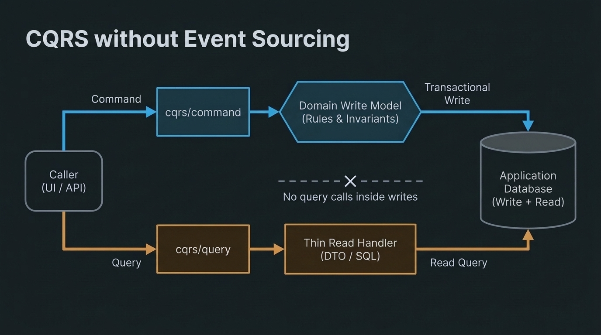

`eventsalsa/cqrs` provides lightweight, transport- and database-free building blocks for Command and Query Responsibility Segregation (CQRS) in Go.

It gives your application explicit contracts for write commands and read queries without coupling your code to any SQL driver, ORM, event store, projection daemon, or HTTP framework. Only the Go standard library and `github.com/google/uuid` are required, so `eventsalsa/cqrs` fits naturally in relational CRUD applications as well as event-sourced systems.

> `eventsalsa.dev/cqrs` is currently in the `0.0.*` pre-release series while its ergonomics stabilize prior to `v0.1.0`.

## What is CQRS?

CQRS is an architectural pattern that splits **domain logic that moves the system forward** (commands) from **UI and reporting read operations** (queries).

In a traditional CRUD model, one set of entities and repositories handles both jobs—enforcing invariants safely during state transitions while assembling joined, filtered views for screens and APIs. As an application grows, read optimizations leak into domain entities and write constraints complicate queries.

Splitting commands from queries improves modifiability and performance, among other quality attributes:

- **Modifiability:** Write handlers stay focused on business rules and state transitions, while read handlers adapt to screen layouts, filters, pagination, and response DTOs without risking regressions in domain invariants.
- **Performance:** Read paths skip domain entity hydration, ORMs, and write locks. Queries can issue tailored SQL joins or read precomputed views independently of how write state is validated and stored.

:::note
**CQRS vs. Event Sourcing**

Although CQRS and Event Sourcing are frequently bundled together, neither requires the other—both can be implemented independently.

However, Event Sourcing paves a natural path toward CQRS. An append-only event store is designed for recording facts and reloading single streams during writes, not for serving general queries such as filtering, search, or multi-record UI views. Because event-sourced systems maintain dedicated read models (projections) for queries, write and read paths separate naturally.
:::

### Flavors of CQRS

#### 1. CQRS without Event Sourcing

Write handlers validate business rules and update application tables inside database transactions; read handlers execute tailored SQL queries or view lookups directly against the database without introducing event streams or eventual consistency.

<div class="diagram-light">


</div>

<div class="diagram-dark">



</div>

#### 2. CQRS with Event Sourcing

When an application stores domain history as immutable facts instead of updating rows in place, commands append events to an event store while projections populate query-friendly read tables. See [CQRS with Event Sourcing in eventsalsa](#cqrs-with-event-sourcing-in-eventsalsa) for how the components connect.

<div class="diagram-light">


</div>

<div class="diagram-dark">


</div>

:::note
**Common misconception: invoking queries inside write workflows**

Developers often start by invoking read-side queries inside command handlers or application business flows. In CQRS, queries are best kept lightweight, dumb, side-effect-free, and focused on servicing UIs, API responses, and reports.

Calling read queries from write flows re-couples UI presentation assumptions (formatting, filtering, caching, pagination) back to business rules—and when read models update asynchronously, commands decide invariants against stale data rather than authoritative transactional state. Inside a command handler, load the authoritative state directly from your write-side repository or event stream.
:::

## Package layout

| Package | Responsibility |
| --- | --- |
| `eventsalsa.dev/cqrs` | Shared types, context helpers, and common sentinel errors |
| `eventsalsa.dev/cqrs/command` | Write-side command handling, routing, middlewares, and failure policies |
| `eventsalsa.dev/cqrs/query` | Read-side query handling, typed execution, routing, and middlewares |
| `eventsalsa.dev/cqrs/spectest` | In-memory `Given / When / Then` specs for pure domain logic |

## Installation

Add `eventsalsa.dev/cqrs` to your Go module (`Go 1.27.4+` required):

```bash
go get eventsalsa.dev/cqrs
```

No database migrations or background workers are needed for this module. For complete runnable programs with and without Event Sourcing, browse [`cqrs/examples`](https://github.com/eventsalsa/eventsalsa/tree/main/cqrs/examples).

## The write side

Commands represent an intent to validate a rule and change application state. Because write operations either succeed or report why they could not proceed, handlers in `eventsalsa.dev/cqrs/command` return only `error`.

### Registering and dispatching commands

You can organize commands around a central `command.Bus` or wire individual handlers directly:

- **With `command.Bus`:** Register each concrete command type once at startup (`command.Register` or `command.MustRegister`) and dispatch commands from HTTP handlers, background workers, or policies via `bus.Dispatch(ctx, cmd)`.
- **Without a bus:** Wrap an individual `command.Handler[C]` with `command.Wrap(handler, mw...)` and pass the wrapped `command.Handler[C]` straight to callers that invoke `Handle(ctx, cmd)` explicitly.

The example below defines a `PlaceOrder` command, attaches a handler to `command.Bus`, and dispatches a command:

```go
package main

import (
	"context"
	"log/slog"

	"eventsalsa.dev/cqrs/command"
)

type PlaceOrder struct {
	OrderID    string
	CustomerID string
	TotalCents int64
}

func dispatchOrderExample(ctx context.Context, orders OrderRepository, logger *slog.Logger) error {
	bus, err := command.NewBus(
		command.WithMiddleware(command.ObservabilityMiddleware()),
	)
	if err != nil {
		return err
	}

	placeOrder := command.Func[PlaceOrder](func(ctx context.Context, cmd PlaceOrder) error {
		return orders.Create(ctx, cmd.OrderID, cmd.CustomerID, cmd.TotalCents)
	})

	if regErr := command.Register(bus, placeOrder); regErr != nil {
		return regErr
	}

	return bus.Dispatch(ctx, PlaceOrder{
		OrderID:    "ord-100",
		CustomerID: "cust-42",
		TotalCents: 14900,
	})
}
```

Dispatch looks up the exact dynamic Go type passed to `Dispatch`, so registering `PlaceOrder` expects callers to pass a value `PlaceOrder{...}` rather than a pointer `&PlaceOrder{...}`. Registering an interface type fails at startup with `cqrs.ErrInvalidMessageType`.

### Write middlewares

Write middlewares wrap command execution to handle cross-cutting work such as transactions, logging, metrics, or retries. Attach them globally via `command.WithMiddleware(...)`, per command type in `command.Register(bus, handler, mw...)`, or directly via `command.Wrap(handler, mw...)`. Middlewares run **outermost-first** in the order listed (`nil` middlewares are skipped).

Custom middlewares implement `command.Middleware` (`func(next command.UntypedFunc) command.UntypedFunc`). For example, here is a middleware that runs each command inside a database transaction:

```go
func withTransaction(db *sql.DB) command.Middleware {
	return func(next command.UntypedFunc) command.UntypedFunc {
		return func(ctx context.Context, cmd any) error {
			tx, err := db.BeginTx(ctx, nil)
			if err != nil {
				return err
			}
			defer tx.Rollback()

			if err := next(contextWithTx(ctx, tx), cmd); err != nil {
				return err
			}
			return tx.Commit()
		}
	}
}
```

Two write middlewares ship out of the box:

- **`command.ObservabilityMiddleware`**: Assigns a fresh `CommandID` per dispatch and propagates `TraceID` and `CausationID` on `ctx` (see [Observability](#observability)).
- **`command.RetryMiddleware`**: Retries failures matching `RetryConfig.RetryIf` (such as optimistic concurrency conflicts) using full-jitter exponential backoff up to `MaxAttempts`. Delays are drawn uniformly from `[0, min(BaseBackoff * 2^(attempt-1), MaxBackoff)]`, defaulting `MaxBackoff` to `250ms` and `BaseBackoff` to `min(10ms, MaxBackoff)`. Context cancellation aborts both before starting an attempt and during backoff sleeps.

```go
bus, err := command.NewBus(
	command.WithMiddleware(
		command.ObservabilityMiddleware(),
		command.RetryMiddleware(command.RetryConfig{
			MaxAttempts: 3,
			BaseBackoff: 10 * time.Millisecond,
			MaxBackoff:  250 * time.Millisecond,
			RetryIf: func(err error) bool {
				return errors.Is(err, errOptimisticConcurrency)
			},
		}),
		withTransaction(db),
	),
)
```

Mount `ObservabilityMiddleware` **outside** `RetryMiddleware` so retry attempts keep one `CommandID`, and mount transaction middlewares **inside** `RetryMiddleware` so every retry begins in a clean transaction after rollback.

### Failure boundaries

Not every failure from a command means the same thing to a caller:

- **Pre-dispatch caller bugs** (`cqrs.ErrNilBus`, `command.ErrNilCommand`, `cqrs.ErrNoHandler`, or an already-canceled `ctx.Err()`) always return immediately before middlewares or handlers execute.
- **Domain rejections** (`"order already canceled"`, `"insufficient balance"`) are deterministic business outcomes.
- **Infrastructure faults** (database unreachable, network timeout) indicate operational failures that callers or workers must handle or retry.

Wrap expected rejections inline with `command.Reject(err)` or centrally via `command.WithErrorClassifier` on `command.Bus`, and observe them with `command.WithOnRejected`:

```go
bus, err := command.NewBus(
	command.WithMiddleware(command.ObservabilityMiddleware()),
	command.WithErrorClassifier(func(err error) error {
		if errors.Is(err, errInsufficientBalance) {
			return command.Reject(err)
		}
		return err
	}),
	command.WithOnRejected(func(ctx context.Context, rejected any, err error) {
		slog.WarnContext(ctx, "command rejected",
			"trace_id", cqrs.TraceIDFromContext(ctx),
			"command", fmt.Sprintf("%T", rejected),
			"err", err,
		)
	}),
)
```

By default, `command.Bus` masks marked rejections (`WithOnRejected` is called and `Dispatch` returns `nil`) while letting unmarked infrastructure errors surface to the caller. Two alternative policies are available on `command.NewBus`:

| Option | Behavior on post-lookup errors | Typical fit |
| --- | --- | --- |
| *(default)* Rejection masking | Marked rejections invoke `WithOnRejected` and return `nil`; unmarked errors return untouched | Edge dispatchers separating domain rejections from infra failures |
| `command.WithStrictOpaqueDispatch(onError)` | Forwards all post-lookup failures to `onError` and always returns `nil` (`ErrNilErrorSink` if `onError` is nil) | Strict boundary handlers where callers never inspect downstream errors |
| `command.WithPassthroughErrors()` | Returns every handler and middleware error untouched | HTTP controllers mapping domain errors to status codes, and integration tests |

## The read side

Queries retrieve data shaped for UIs, API responses, and reports without altering system state. Handlers in `eventsalsa.dev/cqrs/query` return `(R, error)`, and failures returned by handlers or middlewares propagate directly back to callers without rejection masking.

### Executing queries

Register each query handler once via `query.Register` (or `query.MustRegister`) and invoke `query.Execute[R](ctx, bus, q)` with the expected return type `R`—Go infers query type `Q` from `q`:

```go
type GetOrder struct{ OrderID string }
type OrderView struct{ OrderID, Status string }

func readOrderExample(ctx context.Context, views OrderViewReader) (OrderView, error) {
	qBus, err := query.NewBus(
		query.WithMiddleware(query.ObservabilityMiddleware()),
	)
	if err != nil {
		return OrderView{}, err
	}

	query.MustRegister(qBus, query.Func[GetOrder, OrderView](
		func(ctx context.Context, q GetOrder) (OrderView, error) {
			return views.LoadOrder(ctx, q.OrderID)
		},
	))

	// R (OrderView) is passed once; Q (GetOrder) is inferred from the argument.
	return query.Execute[OrderView](ctx, qBus, GetOrder{OrderID: "ord-100"})
}
```

At runtime `query.Execute` verifies that the returned value matches `R`, returning `query.ErrInvalidResultType` if a handler or buggy middleware yields an incompatible type. Returning a typed `nil` pointer maps cleanly to the zero value of `R` without error. If you prefer direct dependency wiring without a bus, use `query.Wrap(handler, mw...)` and call `.Handle(ctx, q)`.

### Query middlewares

Query middlewares (`query.Middleware` wrapping `query.UntypedFunc`) run outermost-first around query execution—globally via `query.WithMiddleware(...)`, per query type via `query.Register`, or directly via `query.Wrap`.

Typical read middlewares enforce query timeouts, collect latency metrics, or manage read-only transactions. For example, here is a custom middleware applying a default timeout when a caller context has no deadline:

```go
func withDefaultTimeout(d time.Duration) query.Middleware {
	return func(next query.UntypedFunc) query.UntypedFunc {
		return func(ctx context.Context, q any) (any, error) {
			if _, ok := ctx.Deadline(); ok {
				return next(ctx, q)
			}
			timeoutCtx, cancel := context.WithTimeout(ctx, d)
			defer cancel()
			return next(timeoutCtx, q)
		}
	}
}
```

Use **`query.ObservabilityMiddleware()`** to ensure an active `TraceID` exists during standalone read execution without allocating synthetic `CommandID` values or clearing existing causal context.

## Observability

When workflows dispatch nested commands—or record facts in [`eventsalsa/store`](../store/) consumed asynchronously by [`eventsalsa/projector`](../projector/)—tracking which request started a flow (`TraceID`) and which command caused each step (`CommandID` -> `CausationID`) links distributed execution into an exact causal tree.

Root package `cqrs` stores these three identifiers in `cqrs.Observability` on `context.Context`:

- **`TraceID`**: Remains constant across the entire workflow. Seed it at the ingress boundary with `cqrs.WithTraceID(ctx, id)` (for example from an HTTP trace header), or let `ObservabilityMiddleware` generate one automatically.
- **`CommandID`**: Freshly generated on every command dispatch so retries and follow-up commands remain distinct.
- **`CausationID`**: Captures the incoming context's `CommandID` whenever one command dispatches another.

```go
seedCtx := cqrs.WithTraceID(ctx, "http-req-9a1f")

// Inside PlaceOrder command handler:
// obs, _ := cqrs.ObservabilityFromContext(ctx)
// -> obs.TraceID == "http-req-9a1f", obs.CommandID == "<cmd-1>", obs.CausationID == ""
//
// If PlaceOrder dispatches ConfirmOrder using ctx:
// -> obs.TraceID == "http-req-9a1f", obs.CommandID == "<cmd-2>", obs.CausationID == "<cmd-1>"
```

Use `cqrs.ObservabilityFromContext`, `cqrs.TraceIDFromContext`, `cqrs.CommandIDFromContext`, or `cqrs.CausationIDFromContext` inside handlers, loggers, and persistence adapters (for example copying `obs.TraceID` to `store.Event.TraceID` and `obs.CommandID` to `store.Event.CausationID`).

By default, IDs are generated via `github.com/google/uuid` (`uuid.NewString`). Pass `WithIDGenerator(fn)` to either `command.ObservabilityMiddleware` or `query.ObservabilityMiddleware` to use UUIDv7 or deterministic IDs in tests.

## CQRS with Event Sourcing in eventsalsa

In an event-sourced service, `eventsalsa/cqrs` sits at the application boundary alongside [`eventsalsa/store`](../store/) and [`eventsalsa/projector`](../projector/):

1. **Write pipeline (`cqrs/command`)**: A command enters `command.Bus` (`ObservabilityMiddleware` -> `RetryMiddleware` for `store.ErrOptimisticConcurrency` -> transaction middleware).
2. **Reconstitution and decision**: Inside the write transaction, the handler reads the aggregate stream from [`eventsalsa/store`](../store/), folds past events (`initial` -> `evolve`) to rebuild decision state, executes pure business rules (`decide`) to emit new facts, and appends them with `store.NoStream()` or `store.Exact(version)`. Fields from `cqrs.ObservabilityFromContext(ctx)` copy onto `store.Event.TraceID` and `store.Event.CausationID`.
3. **Projection into read models**: Committed events update query-friendly tables either **inline inside the write transaction** (for immediate read-after-write consistency) or **asynchronously** via [`eventsalsa/projector`](../projector/) (for independent scaling and isolation).
4. **Query execution (`cqrs/query`)**: Read endpoints run lightweight queries via `query.Execute` directly against those projected tables without replaying event streams or invoking write logic.

Dedicated `cqrs/persistence` helpers will arrive in a follow-up module. Meanwhile, you can inspect full working code for both patterns in [`cqrs/examples`](https://github.com/eventsalsa/eventsalsa/tree/main/cqrs/examples):

- **CQRS without Event Sourcing:** [`cqrs/examples/simple`](https://github.com/eventsalsa/eventsalsa/tree/main/cqrs/examples/simple)
- **CQRS with `eventsalsa/store` Event Sourcing:** [`cqrs/examples/event-sourcing`](https://github.com/eventsalsa/eventsalsa/tree/main/cqrs/examples/event-sourcing)

## Testing

`eventsalsa.dev/cqrs/spectest` provides an in-memory `Given / When / Then` test harness over pure state folding (`initial`, `evolve`) and command decision (`decide`) functions—verifying domain rules in sub-millisecond unit tests with no database setup:

```go
package order_test

import (
	"errors"
	"testing"

	"eventsalsa.dev/cqrs/spectest"
)

var (
	errAlreadyPlaced = errors.New("order already placed")
	errNotPlaced     = errors.New("order not placed")
)

type OrderPlaced struct{ CustomerID string }
type OrderConfirmed struct{}

type PlaceOrder struct{ CustomerID string }
type ConfirmOrder struct{}

type OrderState struct {
	ID         string
	CustomerID string
	Placed     bool
	Confirmed  bool
}

func initialOrder(id string) OrderState {
	return OrderState{ID: id}
}

func evolveOrder(s OrderState, ev any) OrderState {
	switch e := ev.(type) {
	case OrderPlaced:
		s.CustomerID = e.CustomerID
		s.Placed = true
	case OrderConfirmed:
		s.Confirmed = true
	}
	return s
}

func decidePlaceOrder(s OrderState, cmd PlaceOrder) ([]any, error) {
	if s.Placed {
		return nil, errAlreadyPlaced
	}
	return []any{OrderPlaced{CustomerID: cmd.CustomerID}}, nil
}

func decideConfirmOrder(s OrderState, _ ConfirmOrder) ([]any, error) {
	if !s.Placed {
		return nil, errNotPlaced
	}
	if s.Confirmed {
		return nil, nil // idempotent no-op
	}
	return []any{OrderConfirmed{}}, nil
}

func TestOrderSpecs(t *testing.T) {
	t.Parallel()

	spec := spectest.For(t, initialOrder, evolveOrder)

	spec.When("ord-1", PlaceOrder{CustomerID: "cust-42"}, decidePlaceOrder).
		Then(OrderPlaced{CustomerID: "cust-42"}).
		ThenState(func(s OrderState) {
			if !s.Placed || s.CustomerID != "cust-42" {
				t.Fatalf("unexpected state: %+v", s)
			}
		})

	spec.Given(
		OrderPlaced{CustomerID: "cust-42"},
		OrderConfirmed{},
	).When("ord-1", ConfirmOrder{}, decideConfirmOrder).
		ThenNoEvents()

	spec.Given().
		When("ord-1", ConfirmOrder{}, decideConfirmOrder).
		ThenErrorIs(errNotPlaced)
}
```

Use `Then(...)` to assert emitted events (`reflect.DeepEqual`), `ThenNoEvents()` for idempotent no-ops, `ThenState(...)` for resulting state checks, and `ThenError()` / `ThenErrorIs(...)` / `ThenErrorCheck(...)` for expected business rejections.
