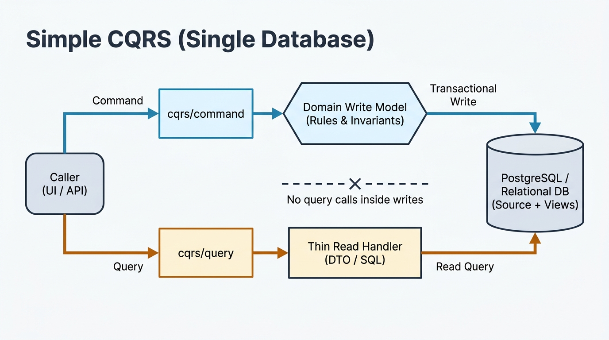
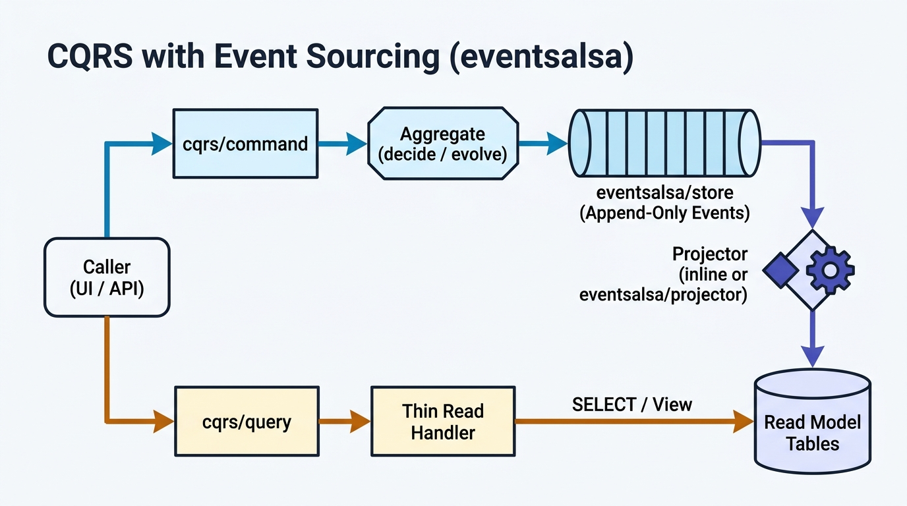
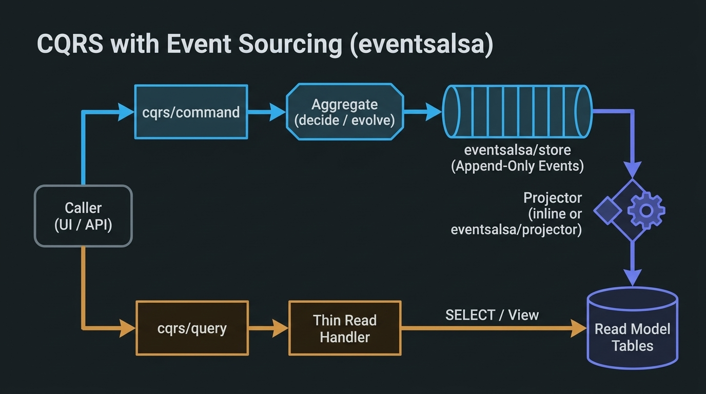

`eventsalsa/cqrs` provides lightweight, transport- and database-free building blocks for Command and Query Responsibility Segregation (CQRS) in Go.

It gives your application explicit contracts for write commands and read queries without coupling your code to any SQL driver, ORM, event store, projection daemon, or HTTP framework. Only the Go standard library and `github.com/google/uuid` are required, so `eventsalsa/cqrs` fits naturally in relational CRUD applications as well as event-sourced systems.

## What is CQRS?

CQRS is an architectural pattern that splits **domain logic that moves the system forward** (commands) from **UI and reporting read operations** (queries).

In a traditional CRUD model, one set of entities and repositories handles both jobs—enforcing invariants safely during state transitions while assembling joined, filtered views for screens and APIs. As an application grows, read optimizations leak into domain entities and write constraints complicate queries.

Splitting commands from queries improves modifiability and performance, among other quality attributes:

- **Modifiability:** Write handlers stay focused on business rules and state transitions, while read handlers adapt to screen layouts, filters, pagination, and response DTOs without risking regressions in domain invariants.
- **Performance:** Read paths skip domain entity hydration, ORMs, and write locks. Queries can issue tailored SQL joins or read precomputed views independently of how write state is validated and stored.

:::note
**CQRS vs. Event Sourcing**

Although CQRS and Event Sourcing are frequently bundled together, neither requires the other—both can be implemented independently.

However, Event Sourcing paves a natural path toward CQRS. An append-only event store is designed for recording facts and reloading single streams during writes, not for serving general queries such as filtering, search, or multi-record UI views. Because event-sourced systems maintain dedicated read models (projections) for queries, write and read paths separate naturally.
:::

### Flavors of CQRS

#### 1. CQRS without Event Sourcing

Write handlers validate business rules and update application tables inside database transactions; read handlers execute tailored SQL queries or view lookups directly against the database without introducing event streams or eventual consistency.

<div class="diagram-light">



</div>

<div class="diagram-dark">


</div>

#### 2. CQRS with Event Sourcing

When an application stores domain history as immutable facts instead of updating rows in place, commands append events to an event store while projections populate query-friendly read tables. See [CQRS with Event Sourcing in eventsalsa](#cqrs-with-event-sourcing-in-eventsalsa) for how the components connect.

<div class="diagram-light">



</div>

<div class="diagram-dark">



</div>

:::note
**Common misconception: invoking queries inside write workflows**

Developers often start by invoking read-side queries inside command handlers or application business flows. In CQRS, queries are best kept lightweight, dumb, side-effect-free, and focused on servicing UIs, API responses, and reports.

Calling read queries from write flows re-couples UI presentation assumptions (formatting, filtering, caching, pagination) back to business rules—and when read models update asynchronously, commands decide invariants against stale data rather than authoritative transactional state. Inside a command handler, load the authoritative state directly from your write-side repository or event stream.
:::

## Package layout

| Package | Responsibility |
| --- | --- |
| `eventsalsa.dev/cqrs` | Shared types, context helpers, and common sentinel errors |
| `eventsalsa.dev/cqrs/command` | Write-side command handling, routing, middlewares, and failure policies |
| `eventsalsa.dev/cqrs/query` | Read-side query handling, typed execution, routing, and middlewares |
| `eventsalsa.dev/cqrs/spectest` | In-memory `Given / When / Then` specs for pure domain logic |

## Installation

Add `eventsalsa.dev/cqrs` to your Go module (`Go 1.27.4+` required):

```bash
go get eventsalsa.dev/cqrs
```

No database migrations or background workers are needed for this module. For complete runnable programs with and without Event Sourcing, browse [`cqrs/examples`](https://github.com/eventsalsa/eventsalsa/tree/main/cqrs/examples).

## The write side

Imagine building an order checkout service. When a customer submits an order, the service needs to verify the order total is valid, enforce domain rules, and save the new order in your database. In CQRS, that intent to change application state is modeled as a **command** (`eventsalsa.dev/cqrs/command`). Because commands mutate state rather than render screens, write handlers return only `error`.

Start by defining the customer's intent as a plain Go struct carrying only the inputs needed to validate rules and make the change:

```go
type PlaceOrder struct {
	OrderID    string
	CustomerID string
	TotalCents int64
}
```

Rather than placing business rules inside an HTTP controller or queue consumer, put validation and persistence inside a command handler so every caller goes through the exact same domain boundary. Define a struct holding your dependencies with a `Handle` method implementing `command.Handler[PlaceOrder]` (or pass `command.Func[PlaceOrder]` for standalone functions):

```go
var errInvalidTotal = errors.New("order total must be positive")

type PlaceOrderHandler struct {
	orders OrderRepository
}

func (h *PlaceOrderHandler) Handle(ctx context.Context, cmd PlaceOrder) error {
	if cmd.TotalCents <= 0 {
		return errInvalidTotal
	}
	return h.orders.SaveNew(ctx, cmd.OrderID, cmd.CustomerID, cmd.TotalCents)
}
```

At application startup, create a `command.Bus` and register each command handler once. One bus acts as the central entry point where cross-cutting concerns—database transactions, logging, retries, and rejection rules—apply uniformly across all commands:

```go
bus, err := command.NewBus()
if err != nil {
	return err
}

if regErr := command.Register(bus, &PlaceOrderHandler{orders: orders}); regErr != nil {
	return regErr
}
```

Inside your HTTP handler, CLI command, or worker, decode the request into `PlaceOrder` and call `bus.Dispatch`. The bus finds the matching handler, runs any configured middlewares around it, executes `Handle`, and returns any unmasked error:

```go
mux.HandleFunc("POST /orders", func(w http.ResponseWriter, r *http.Request) {
	err := bus.Dispatch(r.Context(), PlaceOrder{
		OrderID:    "ord-100",
		CustomerID: "cust-42",
		TotalCents: 14900,
	})
	if err != nil {
		http.Error(w, "command dispatch failed", http.StatusInternalServerError)
		return
	}
	w.WriteHeader(http.StatusAccepted)
})
```

If an endpoint prefers receiving an explicit typed dependency instead of routing through a shared bus, decorate a single handler directly at startup with `placeOrder, err := command.Wrap(&PlaceOrderHandler{orders: orders}, mw...)` and invoke `placeOrder.Handle(r.Context(), cmd)` directly.

### Command bus middlewares

Middlewares wrap command execution to add cross-cutting behavior such as database transactions, logging, tracing, or retries. You can attach middlewares:

- Globally across a bus via `command.WithMiddleware(mw1, mw2)`
- Per command route via `command.Register(bus, handler, routeMW...)`
- Around a standalone handler via `command.Wrap(handler, mw...)`
- Combined into a reusable middleware via `command.Chain(mw1, mw2)`

Middlewares execute **outermost-first** in the order listed (`nil` entries are skipped): the first middleware listed runs first before the handler and inspects returned errors last.

Custom middlewares implement `command.Middleware` (`func(next command.UntypedFunc) command.UntypedFunc`). For example, here is a middleware wrapping every command inside a SQL transaction:

```go
func withTransaction(db *sql.DB) command.Middleware {
	return func(next command.UntypedFunc) command.UntypedFunc {
		return func(ctx context.Context, cmd any) error {
			tx, err := db.BeginTx(ctx, nil)
			if err != nil {
				return err
			}
			defer tx.Rollback()

			if err := next(contextWithTx(ctx, tx), cmd); err != nil {
				return err
			}
			return tx.Commit()
		}
	}
}
```

Two write middlewares are included in `cqrs/command`:

- **`command.ObservabilityMiddleware(opts...)`**: Generates a `CommandID` per dispatch and propagates `TraceID` and `CausationID` on `ctx` (see [Observability](#observability)).
- **`command.RetryMiddleware(cfg)`**: Retries transient errors matching `RetryConfig.RetryIf` using full-jitter exponential backoff up to `MaxAttempts`. Sleep delays are sampled uniformly from `[0, min(BaseBackoff * 2^(attempt-1), MaxBackoff)]`, defaulting `MaxBackoff` to `250ms` and `BaseBackoff` to `min(10ms, MaxBackoff)`. When `RetryIf` is `nil` or `MaxAttempts <= 1`, handlers execute once without retrying. Context cancellation aborts before each attempt and during backoff sleeps.

```go
bus, err := command.NewBus(
	command.WithMiddleware(
		command.ObservabilityMiddleware(),
		command.RetryMiddleware(command.RetryConfig{
			MaxAttempts: 3,
			BaseBackoff: 10 * time.Millisecond,
			MaxBackoff:  250 * time.Millisecond,
			RetryIf: func(err error) bool {
				return errors.Is(err, errOptimisticConcurrency)
			},
		}),
		withTransaction(db),
	),
)
```

Mount `ObservabilityMiddleware` **outside** `RetryMiddleware` so retry attempts share one `CommandID`, and mount transaction middlewares **inside** `RetryMiddleware` so each retry starts a clean transaction after rollback.

### Failure boundaries

`command.Bus` separates errors by caller and operational responsibility:

- **Pre-dispatch errors** (`cqrs.ErrNilBus`, `command.ErrNilCommand`, `cqrs.ErrNoHandler`, or an already-canceled `ctx.Err()`) always return immediately before lookup or middlewares run.
- **Domain rejections** are expected business-rule refusals (such as `"insufficient balance"` or `"order already canceled"`). Mark them inline with `command.Reject(err)` or centrally on `command.NewBus` using `command.WithErrorClassifier`. Inspect marked errors using `command.IsRejected(err)`.
- **Infrastructure faults** (database outages, timeouts, network errors) remain unmarked so retries, alerts, and HTTP `500` handling trigger as expected.

```go
bus, err := command.NewBus(
	command.WithMiddleware(command.ObservabilityMiddleware()),
	command.WithErrorClassifier(func(err error) error {
		if errors.Is(err, errInvalidTotal) {
			return command.Reject(err)
		}
		return err
	}),
	command.WithOnRejected(func(ctx context.Context, rejected any, err error) {
		slog.WarnContext(ctx, "command rejected",
			"trace_id", cqrs.TraceIDFromContext(ctx),
			"command", fmt.Sprintf("%T", rejected),
			"err", err,
		)
	}),
)
```

Configure post-lookup failure behavior via `command.NewBus` options:

| Option | Behavior on post-lookup errors | Typical fit |
| --- | --- | --- |
| *(default)* Rejection masking | Marked rejections invoke `WithOnRejected` and return `nil`; unmarked errors return untouched | Edge dispatchers separating domain rejections from infra failures |
| `command.WithStrictOpaqueDispatch(onError)` | Forwards every post-lookup failure to `onError` and always returns `nil` (`command.ErrNilErrorSink` if nil) | Strict boundary callers that must never branch on downstream errors |
| `command.WithPassthroughErrors()` | Returns every handler and middleware error untouched | HTTP controllers mapping domain errors to status codes, and integration tests |

:::tip
**Why rejection masking is the default**

In CQRS, transport edges such as HTTP handlers, CLI commands, or message consumers work best when kept thin: accept input, build a command, and dispatch it without branching on domain error values.

Returning domain rejections to the edge and switching on them (for instance mapping internal sentinel errors directly to HTTP status codes) tightly couples outer transport layers to application-core internals. It also gets in the way when switching a command from synchronous in-process execution to asynchronous dispatch, because an asynchronous dispatcher cannot wait on downstream rule evaluation anyway. Masking rejections centrally via `WithOnRejected` while surfacing unexpected infrastructure faults keeps your callers ready for both synchronous and async execution.
:::

<!-- TODO: Expand on transport boundaries and async command dispatch when messaging and Watermill integration are documented. -->

### Registration rules

- **Exact dynamic type lookup**: Registering value type `PlaceOrder` matches `PlaceOrder{...}` and not `&PlaceOrder{...}`. Pick either value or pointer consistently per command type.
- **`command.MustRegister`**: Panics on invalid setup (`cqrs.ErrNilBus`, `cqrs.ErrNilHandler`, `cqrs.ErrInvalidMessageType` for interfaces, or `cqrs.ErrDuplicateHandler` when registering a command type twice), convenient during process startup.
- **Nil messages**: Dispatching an untyped `nil` or typed-nil pointer command fails before execution with `command.ErrNilCommand`.

## The read side

Once orders exist, screens and APIs need to display an order's current status without loading write-side domain logic or triggering business rules. In CQRS, that read path returns presentation-shaped data (`(R, error)`) via `eventsalsa.dev/cqrs/query`, propagating errors directly back to callers with no rejection masking.

Start by defining a small struct carrying the lookup inputs alongside the exact response shape needed by the screen or endpoint:

```go
type GetOrder struct {
	OrderID string
}

type OrderView struct {
	OrderID    string `json:"order_id"`
	Status     string `json:"status"`
	TotalCents int64  `json:"total_cents"`
}
```

Unlike write handlers, queries do not enforce business invariants or rehydrate domain models. Implement `query.Handler[GetOrder, OrderView]` directly on a thin reader struct with a plain SQL query using `pgx` (or pass `query.Func[GetOrder, OrderView]` for simple functions):

```go
type GetOrderHandler struct {
	db *pgxpool.Pool
}

func (h *GetOrderHandler) Handle(ctx context.Context, q GetOrder) (OrderView, error) {
	var view OrderView
	err := h.db.QueryRow(ctx, `
		SELECT order_id, status, total_cents
		FROM orders
		WHERE order_id = $1
	`, q.OrderID).Scan(&view.OrderID, &view.Status, &view.TotalCents)
	return view, err
}
```

At application startup, create a `query.Bus` and register each query type once so shared read concerns—timeouts, metrics, read-only database transactions, and tracing—apply uniformly across queries:

```go
qBus, err := query.NewBus()
if err != nil {
	return err
}

if regErr := query.Register(qBus, &GetOrderHandler{db: db}); regErr != nil {
	return regErr
}
```

Inside your HTTP handler or API endpoint, construct `GetOrder` and call `query.Execute[OrderView]`. You provide the expected response type `OrderView` once in brackets while Go infers `GetOrder` from the argument:

```go
mux.HandleFunc("GET /orders/{id}", func(w http.ResponseWriter, r *http.Request) {
	view, err := query.Execute[OrderView](r.Context(), qBus, GetOrder{
		OrderID: r.PathValue("id"),
	})
	if err != nil {
		http.Error(w, "order could not be loaded", http.StatusInternalServerError)
		return
	}
	_ = json.NewEncoder(w).Encode(view)
})
```

If an endpoint prefers receiving an explicit typed handler rather than routing through a shared bus, decorate a single handler at startup with `getOrder, err := query.Wrap(&GetOrderHandler{db: db}, mw...)` and invoke `getOrder.Handle(r.Context(), GetOrder{OrderID: id})` directly.

:::tip
**Keep query handlers lightweight and disposable**

Query handlers do not guard domain invariants—they exist purely to fetch the data a screen or endpoint needs. Avoid wrapping read operations in shared ORM abstractions or domain models.

Keeping each read handler thin, focused, and easy to rewrite or discard lets you index, reshape, cache, or tune individual read paths independently whenever UI or performance requirements change—without risking write-side logic.
:::

### Query bus middlewares

Query middlewares wrap query execution to enforce read timeouts, collect metrics, or manage read-only database transactions. Attach them globally via `query.WithMiddleware(...)`, per query type in `query.Register(qBus, handler, routeMW...)`, around a standalone handler via `query.Wrap(handler, mw...)`, or combined via `query.Chain(mw1, mw2)`. Middlewares execute **outermost-first** (`nil` entries are skipped).

Custom query middlewares implement `query.Middleware` (`func(next query.UntypedFunc) query.UntypedFunc`). For example, here is a middleware applying a default timeout when a caller context has no deadline:

```go
func withDefaultTimeout(d time.Duration) query.Middleware {
	return func(next query.UntypedFunc) query.UntypedFunc {
		return func(ctx context.Context, q any) (any, error) {
			if _, ok := ctx.Deadline(); ok {
				return next(ctx, q)
			}
			timeoutCtx, cancel := context.WithTimeout(ctx, d)
			defer cancel()
			return next(timeoutCtx, q)
		}
	}
}
```

One read middleware ships in `cqrs/query`:

- **`query.ObservabilityMiddleware(opts...)`**: Ensures an active `TraceID` exists during query execution without allocating synthetic `CommandID` values or clearing existing causal context.

### Execution rules

- **Exact dynamic type lookup**: Registering value type `GetOrder` matches `GetOrder{...}` and not `&GetOrder{...}`. Pick either value or pointer consistently per query type.
- **Result type verification**: At runtime `query.Execute` verifies that the returned value matches `R`, failing with `query.ErrInvalidResultType` if a buggy middleware yields an incompatible type. Returning a typed `nil` pointer maps cleanly to the zero value of `R`.
- **Registration and pre-execution checks**: Passing a `nil` bus (`cqrs.ErrNilBus`), `nil` handler (`cqrs.ErrNilHandler`), interface query type (`cqrs.ErrInvalidMessageType`), duplicate query type (`cqrs.ErrDuplicateHandler`), unregistered query (`cqrs.ErrNoHandler`), or `nil` / typed-nil query (`query.ErrNilQuery`) fails deterministically (`query.MustRegister` panics on invalid registration).

## Observability

When workflows dispatch nested commands—or record facts in [`eventsalsa/store`](../store/) consumed asynchronously by [`eventsalsa/projector`](../projector/)—tracking which request started a flow (`TraceID`) and which command caused each step (`CommandID` -> `CausationID`) links distributed execution into an exact causal tree.

Root package `cqrs` stores these three identifiers in `cqrs.Observability` on `context.Context`:

- **`TraceID`**: Remains constant across the entire workflow. Seed it at the ingress boundary with `cqrs.WithTraceID(ctx, id)` (for example from an HTTP trace header), or let `ObservabilityMiddleware` generate one automatically.
- **`CommandID`**: Freshly generated on every command dispatch so retries and follow-up commands remain distinct.
- **`CausationID`**: Captures the incoming context's `CommandID` whenever one command dispatches another.

```go
seedCtx := cqrs.WithTraceID(ctx, "http-req-9a1f")

// Inside PlaceOrder command handler:
// obs, _ := cqrs.ObservabilityFromContext(ctx)
// -> obs.TraceID == "http-req-9a1f", obs.CommandID == "<cmd-1>", obs.CausationID == ""
//
// If PlaceOrder dispatches ConfirmOrder using ctx:
// -> obs.TraceID == "http-req-9a1f", obs.CommandID == "<cmd-2>", obs.CausationID == "<cmd-1>"
```

Use `cqrs.ObservabilityFromContext`, `cqrs.TraceIDFromContext`, `cqrs.CommandIDFromContext`, or `cqrs.CausationIDFromContext` inside handlers, loggers, and persistence adapters (for example copying `obs.TraceID` to `store.Event.TraceID` and `obs.CommandID` to `store.Event.CausationID`).

By default, IDs are generated via `github.com/google/uuid` (`uuid.NewString`). Pass `WithIDGenerator(fn)` to either `command.ObservabilityMiddleware` or `query.ObservabilityMiddleware` to use UUIDv7 or deterministic IDs in tests.

## CQRS with Event Sourcing in eventsalsa

In an event-sourced service, `eventsalsa/cqrs` sits at the application boundary alongside [`eventsalsa/store`](../store/) and [`eventsalsa/projector`](../projector/):

1. **Write pipeline (`cqrs/command`)**: A command enters `command.Bus` (`ObservabilityMiddleware` -> `RetryMiddleware` for `store.ErrOptimisticConcurrency` -> transaction middleware).
2. **Reconstitution and decision**: Inside the write transaction, the handler reads the aggregate stream from [`eventsalsa/store`](../store/), folds past events (`initial` -> `evolve`) to rebuild decision state, executes pure business rules (`decide`) to emit new facts, and appends them with `store.NoStream()` or `store.Exact(version)`. Fields from `cqrs.ObservabilityFromContext(ctx)` copy onto `store.Event.TraceID` and `store.Event.CausationID`.
3. **Projection into read models**: Committed events update query-friendly tables either **inline inside the write transaction** (for immediate read-after-write consistency) or **asynchronously** via [`eventsalsa/projector`](../projector/) (for independent scaling and isolation).
4. **Query execution (`cqrs/query`)**: Read endpoints run lightweight queries via `query.Execute` directly against those projected tables without replaying event streams or invoking write logic.

Dedicated `cqrs/persistence` helpers will arrive in a follow-up module. Meanwhile, you can inspect complete runnable programs in [`cqrs/examples`](https://github.com/eventsalsa/eventsalsa/tree/main/cqrs/examples):

| Example | Storage Model | Architecture Highlights |
| --- | --- | --- |
| [`without-event-sourcing/iteration-1`](https://github.com/eventsalsa/eventsalsa/tree/main/cqrs/examples/without-event-sourcing/iteration-1) | Single in-memory DB | Direct exported Go `commands`/`queries` structs; `internal/domain` invariants; `internal/application` write handlers; `internal/infra` persistence and read handlers. |
| [`without-event-sourcing/iteration-2`](https://github.com/eventsalsa/eventsalsa/tree/main/cqrs/examples/without-event-sourcing/iteration-2) | Single in-memory DB | Top-level Protobuf `commands`/`queries` contracts; `command.Func` ACL adapters in `internal/infra/acl` mapping to `internal/application` use-case commands; `internal/domain` entity invariants. |
| [`without-event-sourcing/iteration-3`](https://github.com/eventsalsa/eventsalsa/tree/main/cqrs/examples/without-event-sourcing/iteration-3) | Single in-memory DB | Top-level Protobuf `commands`/`queries` contracts; `command.Func` ACL adapters; single generic `NewDeciderHandler` in `internal/application`; pure `Initial`/`Decide`/`Evolve` Decider tested via `cqrs/spectest`. |
| [`event-sourcing`](https://github.com/eventsalsa/eventsalsa/tree/main/cqrs/examples/event-sourcing) | Event log + projection | Append-only events via `eventsalsa/store` paired with a projected read view. |

<!-- TODO(cqrs/persistence): Hidden until cqrs/persistence introduces initial/evolve/decide.

## Testing

`eventsalsa.dev/cqrs/spectest` provides an in-memory `Given / When / Then` test harness over pure state folding (`initial`, `evolve`) and command decision (`decide`) functions—verifying domain rules in sub-millisecond unit tests with no database setup:

```go
package order_test

import (
	"errors"
	"testing"

	"eventsalsa.dev/cqrs/spectest"
)

var (
	errAlreadyPlaced = errors.New("order already placed")
	errNotPlaced     = errors.New("order not placed")
)

type OrderPlaced struct{ CustomerID string }
type OrderConfirmed struct{}

type PlaceOrder struct{ CustomerID string }
type ConfirmOrder struct{}

type OrderState struct {
	ID         string
	CustomerID string
	Placed     bool
	Confirmed  bool
}

func initialOrder(id string) OrderState {
	return OrderState{ID: id}
}

func evolveOrder(s OrderState, ev any) OrderState {
	switch e := ev.(type) {
	case OrderPlaced:
		s.CustomerID = e.CustomerID
		s.Placed = true
	case OrderConfirmed:
		s.Confirmed = true
	}
	return s
}

func decidePlaceOrder(s OrderState, cmd PlaceOrder) ([]any, error) {
	if s.Placed {
		return nil, errAlreadyPlaced
	}
	return []any{OrderPlaced{CustomerID: cmd.CustomerID}}, nil
}

func decideConfirmOrder(s OrderState, _ ConfirmOrder) ([]any, error) {
	if !s.Placed {
		return nil, errNotPlaced
	}
	if s.Confirmed {
		return nil, nil // idempotent no-op
	}
	return []any{OrderConfirmed{}}, nil
}

func TestOrderSpecs(t *testing.T) {
	t.Parallel()

	spec := spectest.For(t, initialOrder, evolveOrder)

	spec.When("ord-1", PlaceOrder{CustomerID: "cust-42"}, decidePlaceOrder).
		Then(OrderPlaced{CustomerID: "cust-42"}).
		ThenState(func(s OrderState) {
			if !s.Placed || s.CustomerID != "cust-42" {
				t.Fatalf("unexpected state: %+v", s)
			}
		})

	spec.Given(
		OrderPlaced{CustomerID: "cust-42"},
		OrderConfirmed{},
	).When("ord-1", ConfirmOrder{}, decideConfirmOrder).
		ThenNoEvents()

	spec.Given().
		When("ord-1", ConfirmOrder{}, decideConfirmOrder).
		ThenErrorIs(errNotPlaced)
}
```

Use `Then(...)` to assert emitted events (`reflect.DeepEqual`), `ThenNoEvents()` for idempotent no-ops, `ThenState(...)` for resulting state checks, and `ThenError()` / `ThenErrorIs(...)` / `ThenErrorCheck(...)` for expected business rejections.

-->
